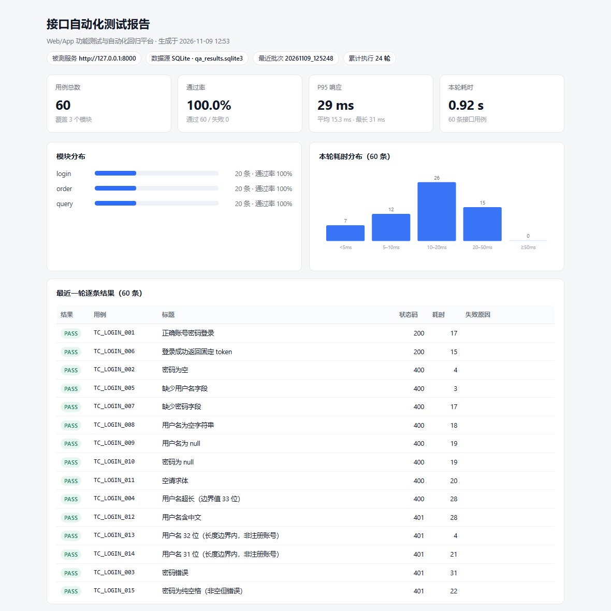

# Web/App 功能测试与自动化回归平台

[](https://github.com/0009527000/qa-automation/actions/workflows/ci.yml)

一个面向软件测试实习岗的个人实践项目：**给一个可运行的 Web 系统做「用例 → 执行 → 缺陷 → 回归 → 报告」的完整闭环**，并预留性能、移动端、AI 用例生成三个扩展模块。



> **重要说明（请先看）**
> 1. 仓库里 `mock_server.py` 是一个**零依赖的最小被测服务**，只用来让框架 clone 后能立刻跑通。正式练习请换成你自己的课程设计或开源业务系统，并相应改写 `cases/*.yaml`。
> 2. 仓库中的 60 条用例是**按 mock 被测服务真实跑通**的回归用例（登录/订单/查询各 20 条）；缺陷台账里的 3 条记录是写用例时**真实发现**的（`quantity` 传布尔被当 1、方法不支持返回 404 而非 405、用户名未 trim），已修复并回归关闭，`python buglog.py list` 可看到三个时间戳。Prompt 模板与评审表仍是**示例/模板**；性能、移动端、AI 评审三块**没有实测数据**，简历里别写。
> 3. 这是测试框架，不是业务系统；写进简历时请如实说明被测对象是什么、你负责的是测试侧工作。

---

## 零、30 秒跑起来（以及跑不动怎么办）

| 你的场景 | 怎么做 |
| --- | --- |
| 只想看到用例跑通 | 在文件管理器里**双击 `run.bat`**（窗口结尾会停住，结果不会一闪而过） |
| 在 VS Code 里 | `Ctrl+Shift+B` → 选「① 运行全部用例（推荐）」，**不需要装任何扩展** |
| 先看环境有没有问题 | `run.bat check`，或 VS Code 任务「④ 环境体检（跑不动先点这个）」 |
| 命令行 | `python launcher.py` / `python launcher.py check` / `python launcher.py verify` |

四个入口最后都走 `launcher.py`：先体检（Python 版本、8000 端口、数据库是否可写），
有问题直接用中文告诉你「哪坏了、怎么修」，没问题再调 `runner.py` 跑用例。

### VS Code 提示「没有扩展 / 找不到调试器 / F5 没反应」

`F5` 调试依赖 **Python** 和 **Python Debugger** 两个扩展。没装时 VS Code 只弹一句
「没有可用的调试器」，看起来像项目坏了，其实跟代码无关。三种解法任选其一：

1. **不装扩展**：用 `Ctrl+Shift+B`（任务实际执行 `cmd /c run.bat`，纯命令行，不依赖扩展），
   或在终端里敲 `python launcher.py`。
2. **装推荐扩展**：用 VS Code 打开本文件夹时，右下角会提示「此工作区有推荐的扩展」，
   点安装（配置在 `.vscode/extensions.json`）；也可在扩展面板搜 `Python`，装
   `ms-python.python`（会连带装 `ms-python.debugpy`）。
3. 装完扩展 F5 仍报「未选择解释器」：`Ctrl+Shift+P` → `Python: Select Interpreter`，
   选一个 Python 3.7+ 即可（本项目零第三方依赖，选哪个都能跑）。

### 其他常见报错

| 现象 | 原因与处理 |
| --- | --- |
| 双击 `run.bat` 窗口一闪而过 | 旧版没有 `pause`；现在结尾一定停住。若仍闪退，多半是安全软件拦了批处理，改用 VS Code 任务 |
| `Python was not found` / `'python' 不是内部或外部命令` | Python 没进 PATH。重装时勾 **Add python.exe to PATH**，或直接用 `py -3 launcher.py` |
| 一堆 `UnicodeEncodeError`、中文变问号 | 控制台是 GBK。用 `run.bat` 启动（它先 `chcp 65001`），或 `set PYTHONUTF8=1` |
| `等待 http://127.0.0.1:8000 超时，端口可能被占用` | 8000 被别的程序占了。`run.bat check` 会指出来；换端口：`set PORT=8010` 且 `set BASE_URL=http://127.0.0.1:8010` |
| 用例全红、全部 401 | 请求打到了别的服务。确认 `BASE_URL` 指向 mock 或你自己的被测系统 |
| `ModuleNotFoundError: common` | 不在项目根目录运行。`run.bat` 已 `cd /d "%~dp0"`；命令行请先 `cd qa-automation` |

---

## 一、它覆盖哪些岗位要求

| 岗位要求 | 仓库里的对应实现 |
| --- | --- |
| Web/App 功能测试、执行用例、提交 Bug | `cases/*.yaml` 等价类 / 边界值 / 异常场景用例；`buglog.py` 缺陷台账 |
| 跟踪修复进度、回归验证 | 缺陷状态 `open → fixed → closed` 带时间戳；`runner.py --tag regression` 回归 |
| 建立与维护自动化脚本、提升效率 | 数据驱动（YAML 用例）+ 统一请求封装 + 一键执行 + CI 定时回归 |
| 性能测试 | `perf/` 压测指引 + 慢查询定位方法（需你真实执行） |
| 移动端专项 | 扩展位，Android 模拟器 + Appium 冒烟（需你真实执行） |
| Python / MySQL | Python 为主；默认 SQLite 零配置，设置环境变量即切 MySQL |
| AI 智能化测试工具预研 | `ai/prompt.md` 生成用例 + `ai/review.md` 人工评审与采纳率统计 |

## 二、三种运行方式（按你的环境挑一个）

> 三种方式都只依赖标准库。想先确认环境没问题，任何一个入口加 `check` 都行：
> `python launcher.py check` / `run.bat check`。

### 方式 A：零依赖直接跑（推荐，什么都不用装）

```bash
python launcher.py            # 推荐：先体检再跑，报错是中文的人话
python runner.py                # 跑全部 60 条用例
python runner.py --tag smoke    # 只跑冒烟
python runner.py --tag regression
python htmlreport.py            # 生成 reports/report.html（单页报告，可打印成 PDF）
```

**不需要 pip install，任何 Python 3.x 都能跑**：用例解析用自带的极简 YAML 解析器（`common/miniyaml.py`），HTTP 请求用标准库 `urllib`，结果写 SQLite。脚本会自动拉起 `mock_server.py`（已在运行就直接复用），跑完自动关掉。

Windows 用户还可以**直接双击**：

| 文件 | 作用 |
| --- | --- |
| `run.bat` | 跑全部用例 + 打印历史统计（日常用得最多） |
| `verify.bat` | 一键自检，等于 `python verify.py` |

### 方式 B：pytest（想用成熟框架 / Allure 报告时）

```bash
pip install -r requirements.txt
python mock_server.py      # 另开一个终端，保持运行
pytest -q                  # 60 passed
pytest -m smoke -q         # 按 YAML 里的 tags 筛选
pytest --alluredir=allure-results -q && allure serve allure-results
```

### 方式 C：VS Code 里一键运行

用 VS Code 打开 **`qa-automation` 这个文件夹本身**（不是它的上级目录），有两种方式：

**不装任何扩展**：`Ctrl+Shift+B` → 选「① 运行全部用例（推荐）」。
任务走的是 `cmd /c run.bat`，纯命令行，不依赖 Python 扩展，最稳。

**装了 Python 扩展**：按 **F5**，在左上角下拉里选：

| 配置 | 作用 |
| --- | --- |
| ① 运行全部用例（推荐） | `launcher.py run` → 跑 `runner.py`，终端直接看逐条结果 |
| ② 只跑冒烟用例 | `runner.py --tag smoke` |
| ③ 一键自检 | `verify.py`：跑用例 + 历史统计 + 顺手生成 HTML 报告 |
| ④ 查看执行统计 | `report.py --md`：历史通过率、趋势、失败清单 |
| ⑤ 环境体检 | `launcher.py check`：Python / 端口 / 数据库出问题先看这个 |

`.vscode/tasks.json` 里另配了 7 个任务（含缺陷台账、HTML 报告），`Ctrl+Shift+P` → `Tasks: Run Task` 也能调。

> 注意：VS Code 用的解释器可能和你装依赖的解释器不是同一个。方式 A 只依赖标准库，所以换哪个解释器都能跑；方式 B 需要在该解释器里装过 `requirements.txt`。

## 三、跑完你能看到什么

一次执行会产出五层结果，都是可直接拿去写周报或面试展示的：

**1. 终端逐条结果**

```
结果       用例             状态码    耗时       标题
[PASS]   TC_LOGIN_001   200    12ms     正确账号密码登录
[PASS]   TC_ORDER_004   401    3ms      未登录提交订单
...
用例 60 条：通过 60，失败 0，通过率 100.0%
耗时：平均 4.6ms，P95 18ms，最长 27ms
RESULT: PASS - 60/60 passed
```

**2. 数据库 `run_result` 表**（`qa_results.sqlite3`，或用 MySQL）

每条用例每次执行一行：`case_id / status / cost_ms / http_code / message / run_at / batch`。失败也记，`message` 里存完整断言信息，所以通过率不会被"只统计成功的用例"美化。`batch` 是批次号，用来精确统计「某一轮执行」。

**3. Markdown 报告**

- `reports/run_report.md`：本次执行的逐条明细（跑完自动生成）
- `reports/report.md`：历史汇总，`python report.py --md` 生成——累计执行次数、通过率、P95 耗时、按模块统计、近 7 天趋势、最近失败清单

**4. 单页 HTML 报告**（`python htmlreport.py` 或 `run.bat html`）

`reports/report.html`，单文件、CSS/SVG 全内联、不依赖 CDN，断网也能开。内容：用例数 / 通过率 / P95 / 本轮耗时的指标卡，模块分布，本轮耗时分布，60 条逐条结果，缺陷台账。
浏览器 Ctrl+P 勾选「背景图形」即可存成 PDF，直接当作品集附件。`一键自检` 跑完会自动生成它。预览图见顶部截图，缺陷明细见 [`docs/bugs.md`](docs/bugs.md)。

**5. 缺陷台账**

`buglog.py` 把「发现 → 修复 → 回归关闭」写成带时间戳的记录，是"Bug 闭环"唯一的可查证据（见第五节）。

## 四、目录结构

```
qa-automation/
├── launcher.py             # 统一入口：环境体检（Python/端口/数据库）+ 中文报错 + 分派脚本
├── runner.py               # 零依赖用例执行器（读 YAML → 请求 → 断言 → 落库 → 报告）
├── verify.py               # 一键自检：执行 + 数据库历史统计
├── report.py               # 历史数据统计报告（终端 / Markdown）
├── htmlreport.py           # 单页 HTML 报告：指标卡 + 图表 + 逐条结果 + 缺陷台账
├── buglog.py               # 缺陷台账：登记 / 修复 / 关闭 / 列表 / 统计
├── mock_server.py          # 零依赖最小被测服务（仅用于演示）
├── cases/                  # YAML 用例：等价类 / 边界值 / 异常场景
│   ├── login.yaml
│   └── order.yaml
├── common/
│   ├── config.py           # BASE_URL / token / 数据库配置（读环境变量）
│   ├── cases.py            # 用例加载（优先 PyYAML，缺失时用 miniyaml）
│   ├── miniyaml.py         # 极简 YAML 解析器，让用例在无依赖环境也能跑
│   ├── http_client.py      # pytest 通道的 requests 封装
│   └── db.py               # 建表 / 迁移 / 结果与缺陷落库，SQLite / MySQL 双支持
├── tests/
│   ├── conftest.py         # 加载用例、初始化库、注入 client、按 tags 打标
│   └── test_api.py         # pytest 参数化执行 + 断言 + 结果（含失败）落库
├── sql/                    # 建表脚本（SQLite / MySQL）
├── ai/                     # 大模型生成用例的 Prompt 与人工评审表
├── perf/README.md          # 压测与慢 SQL 定位指引
├── .vscode/                # F5 调试配置、Ctrl+Shift+B 任务、推荐扩展、UTF-8 设置
├── .github/workflows/ci.yml# push + 每日定时回归，上传报告
├── verify.bat              # Windows 双击自检
├── pytest.ini
└── requirements.txt
```

## 五、缺陷台账怎么用

```bash
# 1. 发现 bug，登记（关联到具体用例，级别 P0-P4）
python buglog.py record TC_ORDER_002 P2 "数量为 0 时返回 500，预期 400 并提示数量非法"

# 2. 研发改完 → 待回归
python buglog.py fix BUG-0001

# 3. 回归通过 → 闭环（写入关闭时间）
python buglog.py close BUG-0001

# 4. 查看与统计
python buglog.py list
python buglog.py stats

# 5. 导出 Markdown 快照（数据库不入库，快照才进仓库）
python buglog.py export
```

`stats` 会给出缺陷总数、各状态数量、关闭率、平均修复时长（从登记到回归关闭）和按级别分布。这些数字就是简历里「N 个 Bug 全部闭环」的依据；没有台账，这句话在面试时经不起追问。

**当前台账（真实数据）**

```
缺陷总数：3    open 0 / fixed 0 / closed 3    关闭率：100.0%
平均修复时长：0.7 分钟（从登记到回归关闭）
按级别：P2 2，P3 1
```

| Bug | 关联用例 | 现象 | 修复方式 |
| --- | --- | --- | --- |
| BUG-0001 P2 | TC_ORDER_020 | `quantity` 传 `true` 被当成 1 下单成功 | 显式排除 `bool` 类型，返回 400/3001 |
| BUG-0002 P3 | TC_ORDER_018 / TC_QUERY_017 | 方法不支持时返回 404，语义错误 | 增加 405 分支，返回 `code: 405` |
| BUG-0003 P2 | TC_LOGIN_018 | 用户名带前后空格时正确密码也登录失败 | 先 `strip()` 再比对 |

修复过程是「先改用例期望 → 跑出 4 条失败 → 登记 → 改服务 → 回归转绿 → 关闭」，失败记录仍在 `run_result` 里可查。

## 六、换成你自己的被测系统

1. 启动你的业务系统，确认有登录、列表查询、表单提交三类接口。
2. 修改 `cases/*.yaml` 里的 `path`、`body`、`expect`，断言要与真实响应一致。
3. `export BASE_URL=http://你的地址`（Windows `set BASE_URL=...`）；如果 token 不是 `X-Token` 头，改 `runner.py` 的 `_request()` 和 `common/http_client.py`。
4. 用例编号、模块、覆盖点保持可追溯，方便后面统计"用例数"和"回归范围"。

## 七、切换到 MySQL（简历写 MySQL 的前提）

```bash
export MYSQL_HOST=127.0.0.1
export MYSQL_USER=root
export MYSQL_PASSWORD=你的密码
export MYSQL_DB=qa_automation
# 先在 MySQL 里执行 sql/init.sql 建库建表
python runner.py
```

`common/db.py` 检测到 `MYSQL_HOST` 就会用 PyMySQL 连接，否则用 SQLite。SQL 里的参数占位符用 `{p}` 统一表示，由 `db.query()` 自动适配 `?` 与 `%s`。**只有在 MySQL 上真实跑过、且能讲清表结构与慢查询分析，简历里才写 MySQL。**

## 八、简历里每个数字怎么真实得到

| 简历可能写的数字 | 从这里取 |
| --- | --- |
| N 条功能用例 | `python runner.py --tag regression` 的用例数，或 `test_case` 表条数 |
| M 个 Bug 全部闭环 | `buglog.py stats` 的总数与关闭率，保留状态流转记录 |
| 回归耗时 A 分钟 → B 分钟 | 手工逐条计时一次；自动化取 `report.py` 里的"本次执行总耗时"，注明机器与用例范围 |
| 平均 / P95 响应时间 | `report.py` 的耗时统计（接口层，不是压测数据，别混用） |
| 压测响应时间 / TPS | `perf/README.md` 的 JMeter 记录，注明并发数、环境、跑几次取均值 |
| AI 用例采纳率 | `ai/review.md` 的生成条数 / 采纳条数，保留被拒绝样例 |
| 移动端冒烟条数 | Appium 运行日志与报告里的用例 ID |

> 数字先跑出来再写进简历，不要反过来。面试时把 `reports/report.md`、`run_result` 表和 JMeter 报告打开，比任何形容词都有说服力。

## 九、CI 与报告

`.github/workflows/ci.yml` 在 push / PR 和每日定时触发：启动 `mock_server.py` → `pytest -m "smoke or regression"` → 生成 Markdown 统计 → 上传 `allure-results` 与 `reports` 作为 artifact。接入自己的被测系统时，把启动步骤换成你的服务或指向测试环境地址。

## 十、局限与可优化点（面试可主动讲）

- 只覆盖接口层，UI 自动化（Selenium / Appium）只留了扩展位，未接入；性能压测没有实测数据。
- 发现的缺陷集中在自写的 mock 服务上，样本量小（3 条），不代表真实业务系统的缺陷分布。
- 用例执行前后没有数据工厂，依赖测试数据预置，后续可加 setup/teardown 造数与清理。
- 没有覆盖率度量、没有 mock 外部依赖，回归范围靠标签人工维护。
- AI 生成用例存在幻觉字段与漏测，必须人工评审后才能入库。
- 结果表没有归档与清理策略，长期跑需要按 `batch` 定期归档。

完整设计说明、两周计划与面试追问清单见项目旁的 `test_project_plan.md`。

## 十一、License

[MIT](LICENSE)
